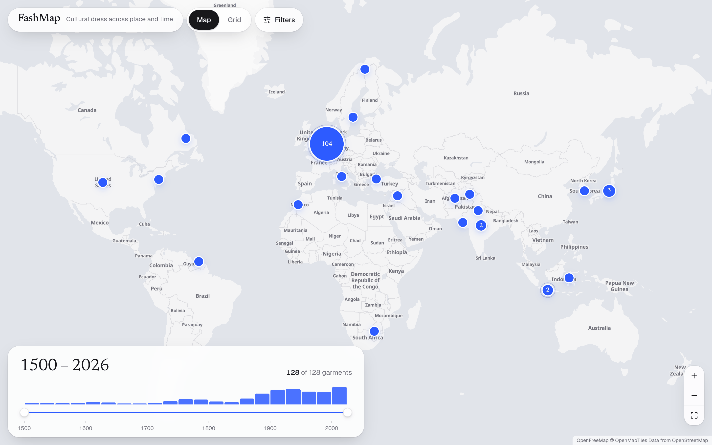

<h1 align="center">FashMap</h1>

<p align="center">
  Cultural dress on a world map, with a timeline and 360° views of every garment.
</p>

<p align="center">
  
</p>

FashMap shows the 128 garments of the [Modemuze](https://modemuze.nl) 360° collection, from regional costume to designer pieces, on a map of where they come from and a timeline of when they were made. You narrow the period on a timeline, click a place to see its garments, and open one to turn it around in 360° next to its photo and details.

It is the course project of Team 7 for Human-Computer Interaction & Information Visualization at Leiden University. The study behind it asks whether a map with a timeline and 3D views helps students understand where and when garments come from better than a standard image grid like Modemuze's.

## Features

- One dot per place on an open-source vector map. Nearby places merge into a single dot when you zoom out and split again as you zoom in.
- A timeline slider for the period, with a bar chart of how many garments fall in each 25 years.
- Filters for garment type and museum. The map, the timeline and the grid all follow them at once.
- Click a dot for the garments of that place, then a garment for a panel with its 360° spin, photo and details. The map stays visible next to it.
- A full page per garment: the spin and a zoomable photo side by side, the Modemuze stories behind the points on the spin, and a full-screen mode for each.
- A grid view in the style of Modemuze, used as the baseline in the study.
- An eval mode that locks a participant to one condition and logs what they do, plus a page to export the logs.
- Works with the keyboard, shows focus, respects reduced motion, and never uses colour as the only cue.

## Quick start

You need [Node.js](https://nodejs.org) 24.2 or newer (`node --version` to check). Nothing else: there are no API keys, environment variables or backend.

```bash
git clone https://github.com/FrisoWiegersma/FashMap.git
cd FashMap
npm ci
npm run dev
```

Open <http://localhost:5173/FashMap/>. Map tiles, 360° spins and photos load from the web, so you need an internet connection.

To try the production build instead:

```bash
npm run build
npm run preview
```

and open <http://localhost:4173/FashMap/>.

## Scripts

| Command | What it does |
|---|---|
| `npm run dev` | Start the dev server with hot reload |
| `npm run build` | Type-check and build the site into `dist/` |
| `npm run preview` | Serve the built site from `dist/` |
| `npm run lint` | Lint with oxlint |
| `npm run check` | Run the checks for the data logic and the importer |

## Running a study

Eval mode is set in the URL. Without `?p` nothing is logged, so normal use leaves no traces.

| URL | What happens |
|---|---|
| `/FashMap/?p=P07&c=map` | Participant P07 in the map condition. The view is locked to the map and events are logged. |
| `/FashMap/?p=P07&c=grid` | Participant P07 in the grid condition: photo and text only, like Modemuze. |
| `/FashMap/?admin=1` | The sessions logged on this device, with a JSON download and a delete button. |

Logs are kept in the browser's local storage, so export them from `?admin=1` on the same device and browser before clearing its data.

The events are `session_start`, `view_change`, `place_open`, `garment_open`, `garment_close`, `filter_change`, `period_change`, `media_switch`, `model_interact`, `full_open`, `full_close`, `story_open` and `photo_switch`. Once a study has started, events are only added, never renamed.

## Data

All garments are in `src/data/garments.json`, which is bundled into the site. The file is generated, so don't edit it by hand. Rebuild it with:

```bash
node scripts/modemuze.ts modemuze-raw.json
```

If `modemuze-raw.json` doesn't exist yet, the script first fetches every object page from modemuze.nl and looks up each place with Nominatim, one request at a time. The raw file holds Modemuze's Dutch texts, so it is ignored by git.

Facts such as museum, maker, materials and dates come from Modemuze and are translated to English. Titles, types and the short summaries are our own, written in `scripts/modemuze-en.json`. Every garment links to its page on Modemuze. Photos, spins and the original stories load from Micrio. English story translations are in `src/data/stories-en.json`, loaded only when a garment is opened; new stories without a translation fall back to Dutch.

To add one of our own 3D scans, see [`public/models/README.md`](public/models/README.md). The [roadmap](roadmap.md) describes the data model, the features and the open decisions.

## Project structure

```
src/
  App.tsx              App state: period, filters, open place and garment
  components/
    MapView.tsx        Map, dots, grouping and the place list
    Timeline.tsx       Period slider and bar chart
    Filters.tsx        Type and museum filters
    ObjectPanel.tsx    Panel next to the map
    Media.tsx          360° spin, 3D model and photo
    CompareView.tsx    Full page of a garment
    GridView.tsx       Grid view (study baseline)
    AdminPage.tsx      Logged sessions (?admin=1)
  lib/
    data.ts            Types, period rule, grouping, filters
    log.ts             Eval mode and logging
    micrio.ts          Stories from Micrio and English translations
  data/garments.json   Generated garment records
  data/stories-en.json English story translations by Micrio and marker id
scripts/
  modemuze.ts          Importer for the Modemuze collection
  modemuze-en.json     English titles, types and summaries
public/models/         Our own .glb scans
```

## Deploying

`npm run build` writes a static site to `dist/` that any static host can serve. It is built for GitHub Pages at `https://<user>.github.io/FashMap/`, so `base` in `vite.config.ts` is `/FashMap/`. For another path, pass it when building, for example `npm run build -- --base=/`.

### Docker

With Docker Engine and Docker Compose installed, build and start the site:

```bash
docker compose up -d --build
```

Open <http://localhost:8080/>. The image builds the app with Node.js and serves only the production files with Nginx (`nginx.conf`: `index.html` is never cached stale, and the map's `.mjs` worker is served as JavaScript). It uses `/` as its base path, so study URLs become `/?p=P07&c=map`, `/?p=P07&c=grid` and `/?admin=1`.

The host port is configurable with `FASHMAP_PORT` and defaults to 8080. It always binds to `127.0.0.1`. For example, use an untracked `.env` file to persist a different port:

```bash
printf 'FASHMAP_PORT=8081\n' > .env
docker compose up -d --build
```

### Homelab and Cloudflare Tunnel

The homelab runs the site from `/home/frisowiegersma/fashmap` as `frisowiegersma`, with `FASHMAP_PORT=8081` in its `.env` file. Port 8080 is used by another service. Transfer the committed source without local files or dependencies:

```bash
git archive HEAD | ssh frisowiegersma@homelabfriso 'mkdir -p /home/frisowiegersma/fashmap && tar -x -C /home/frisowiegersma/fashmap'
ssh frisowiegersma@homelabfriso 'cd /home/frisowiegersma/fashmap && printf "FASHMAP_PORT=8081\n" > .env && docker compose up -d --build fashmap'
```

Use the existing Cloudflare tunnel's published application route with hostname `fashmap.frisowiegersma.com`, service type **HTTP**, and URL `localhost:8081`. The tunnel connector runs on the homelab host. The public site is <https://fashmap.frisowiegersma.com/>; no Tailscale Serve changes are needed.

After updating the code, transfer it and run `docker compose up -d --build fashmap` again. Verify the localhost response on the homelab (`curl -fI http://127.0.0.1:8081/`) and the public HTTPS site, including `/favicon.ico`, `/apple-touch-icon.png`, and the map's `.mjs` worker (served as JavaScript). Map tiles, photos and spins need an internet connection.

View server logs with `docker compose logs -f fashmap`. If deployment or verification fails, stop only this service with `docker compose stop fashmap` from its directory; leave the tunnel and other homelab services running. No database, volumes or registry are needed: study logs stay in each visitor's browser and are specific to the site's origin (scheme, host and port).

## Built with

[Vite](https://vite.dev), [React](https://react.dev), TypeScript, [Tailwind CSS](https://tailwindcss.com), [shadcn/ui](https://ui.shadcn.com) and [Watermelon UI](https://ui.watermelon.sh), [MapLibre](https://maplibre.org) through [react-map-gl](https://visgl.github.io/react-map-gl/), [Micrio](https://micr.io) for the 360° views, [model-viewer](https://modelviewer.dev) for 3D, and [Motion](https://motion.dev).

## Credits

- Garments, photos, 360° spins and stories: [Modemuze](https://modemuze.nl) and its partner museums, served by Micrio. The photos are in copyright and are not part of this repository.
- Map tiles: [OpenFreeMap](https://openfreemap.org), with map data © [OpenStreetMap](https://www.openstreetmap.org/copyright) contributors and [OpenMapTiles](https://openmaptiles.org).
- Place lookup: [Nominatim](https://nominatim.org).
- Fonts: [Geist](https://vercel.com/font) and [Newsreader](https://fonts.google.com/specimen/Newsreader).

## Team

Narek Sergeyan and Friso Wiegersma, Team 7, HCI & IV, Leiden University.

## License

The code and our own texts are released under the [MIT License](LICENSE). The photos, spins and stories belong to Modemuze and the museums and are not covered by it.
